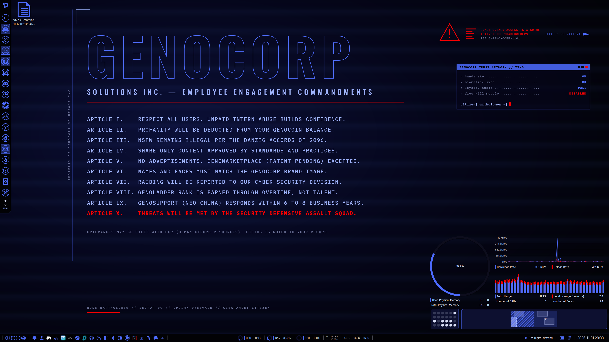
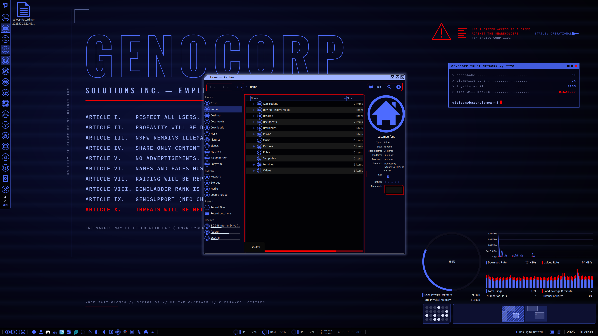
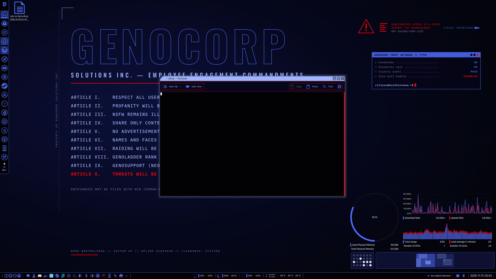
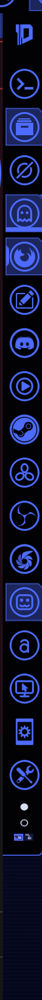
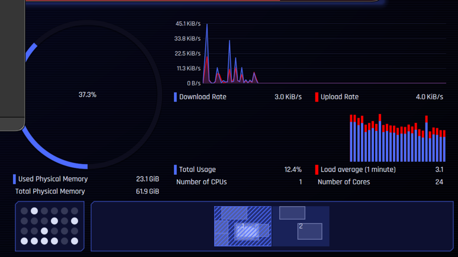

# GenoTheme

GenoCorp's corporate-dystopia theme for **KDE Plasma 6**: near-black navy panels, electric-blue
(`#4d6bff`) lines and selection, pale periwinkle (`#9fb3ff`) highlights and GenoCorp red (`#ff0000`)
for warnings and active accents — matching the GenoCorp site and the *Manifesto* wallpaper
("Employee Engagement Commandments", NODE BARTHOLOMEW).



| Dolphin | Konsole |
|---|---|
|  |  |
| **Dock** | **System monitor widget** |
|  |  |

## What's in it

| Component | Path | Name to pick in System Settings |
|---|---|---|
| Colour scheme | `themes/color-schemes/GenoTheme.colors` | Colours → GenoTheme |
| Plasma style (panels, popups, widgets) | `themes/plasma/desktoptheme/GenoTheme` | Plasma Style → GenoTheme |
| Window decoration (Aurorae) | `themes/aurorae/themes/GenoTheme` | Window Decorations → GenoTheme |
| Kvantum application style (Dolphin etc.) | `themes/kvantum/GenoTheme` | Kvantum Manager → GenoTheme |
| Icons | `themes/icons/GenoTheme-Icons` | Icons → GenoTheme-Icons |
| Konsole colour scheme + profile | `themes/konsole/` | Konsole profile "GenoTheme" |
| GTK theme (Breeze-Dark based, CSS recoloured) | `themes/gtk/GenoTheme-GTK` | Application Style → GNOME/GTK |
| Global theme (includes the Balthasar desktop layout) | `themes/look-and-feel/com.genocorp.genotheme` | Global Theme → GenoTheme |
| Wallpaper package | `wallpaper-package/GenoTheme` | Wallpaper → GenoTheme Manifesto |
| Panel plasmoids | `plasmoids/` | installed for the user, not picked by hand |
| Fonts (Rajdhani, Orbitron, Hack) | `fonts/` | applied by `--apply` |
| Firefox chrome theme | `themes/firefox/GenoThemeFox` | GenoThemeFox (userChrome, not an add-on) |

Palette (from the GenoCorp site CSS):

| Role | Colour |
|---|---|
| Background | `#020205`, `#05061a`, `#080a24` |
| Accent / lines / selection | `#4d6bff` (pure `#0000ff` used sparingly) |
| Highlights | `#9fb3ff` |
| Text / muted | `#d9def5` / `#6a7095` |
| Warnings, close button, active accents | `#ff0000` |

## Install

```bash
./install.sh                   # copy files only (no sudo). Does not change panels, Firefox, or the running theme.
./install.sh --apply           # ...and apply the Balthasar look (see below)
./install.sh --layout          # panels and desktop wallpaper only
./install.sh --restore-panels  # put back the panel config from before the first --apply/--layout
```

Nothing here needs root. The first `--apply` or `--layout` copies the current
`plasma-org.kde.plasma.desktop-appletsrc`, `plasmashellrc` and `kscreenlockerrc`
to `~/.local/share/genotheme/panel-backup/` and will not overwrite that backup
on later runs. `--restore-panels` copies it back and restarts Plasma if it was
running. Colours, fonts, KWin and Firefox are not reverted by the restore.

### What `./install.sh --apply` does

- Copies the theme, the six vendored plasmoids, the wallpaper package and the fonts.
- Sets the colour scheme, Plasma style, icon theme (`GenoTheme-Icons`), Konsole profile and Aurorae decoration.
- Writes `kdeglobals` `[KDE] widgetStyle=kvantum` (Kvantum Manager never did this) and selects the GenoTheme Kvantum theme. If the `kvantum` package is missing it warns and still writes the key; Fedora package: `sudo dnf install kvantum`.
- Installs Rajdhani, Orbitron and Hack under `~/.local/share/fonts/genotheme/` and sets Rajdhani Medium 10 (UI, menus, toolbar), Orbitron 8 (window titles) and Hack 10 (monospace).
- KWin: no borders, blur strength 7 / noise 3, built-in effects (contrast, translucency, magic lamp, scale, slide, fading popups; wobbly windows and squash off), flip alt-tab, animation factor 0.7.
- Wallpaper: GenoTheme Manifesto, crop/fill (`FillMode=2`) on every desktop and on the lock screen.
- Panels, on the primary screen: a 34px bottom status bar (tray, ISO clock with the date beside the time, lock/logout, CPU/RAM/GPU pie+text in `77,107,255`, netspeed, temperatures, media controls, show desktop, overview) and a 46px left dock (GenoTheme launcher icon, task icons, dot pager). Other landscape screens get a 46px floating bottom mini panel. Portrait screens get nothing. The primary screen is always given the full pair, even if it is portrait.
- The dock only pins launchers whose `.desktop` file exists on this machine (`preferred://filemanager` and `preferred://browser` always stay). Glide stays if it is installed; GenoCommand is added beside it when its desktop file exists. CPU, memory, GPU and temperature widgets are omitted when that sensor is not present. A laptop gets `org.kde.plasma.battery` in the tray when it has a single screen that is `eDP`, or a single screen plus a `/sys/class/power_supply/BAT*` battery. `--apply` prints the screens it actually detected (connector, size, orientation, which one is primary). `kscreen-doctor -j` is preferred; the coloured `-o` text is only a fallback, and its ANSI codes are stripped before parsing. If neither command returns a screen, the log says so and assumes one 1920x1080 display.
- Refreshes the icon cache and restarts `plasmashell` when it was already running, so icons and panels show up without logging out. After the restart it asks the running shell to rebuild the panels, matching each panel to a screen by its geometry. The on-disk fallback (used when Plasma is not running) numbers screens in `kscreen-doctor` priority order, with priority 1 as screen 0.
- Firefox: writes GenoThemeFox into the default profile (see below). If Firefox is open, it tells you to quit it completely and start it again.

The same panel script is stamped into the installed look-and-feel package
(`contents/layouts/org.kde.plasma.desktop-layout.js`), so System Settings →
Global Theme → GenoTheme can apply the desktop layout too. Just copying the
files, or switching colours, does not touch the panels.

Restart already-open Qt apps (Dolphin, Konsole, …) to pick up Kvantum.

System Monitor widgets store their own sensor colours. GenoTheme uses `77,107,255` (blue) for the
primary sensor, `255,0,0` (red) for secondary series and `106,112,149` (muted) for background series.

## Rebuilding from Daemon 2.0

Everything under `themes/` (except the hand-written files in `tools/static/`) is generated:

```bash
git clone https://github.com/MathisP75/daemon-kde-mk2.git /tmp/daemon   # built against 01bf4df
python3 tools/recolor.py /tmp/daemon themes
```

`tools/recolor.py` holds the full Daemon → GenoCorp colour map. `tools/custom-icons/` holds the extra
Daemon-style icons made for this machine's apps (Grok, Grok Bot, Affinity, DaVinci Resolve, Glide,
GenoCommand, Stacher7, YouTube Music, Shutter Encoder, Pipeweaver, TuxBox, GenoBeacon, Beacn, Gridcraft,
Vectorcraft, plus the Insync/Steam/Beacn/Glide/GenoCommand tray icons) and the Daemon "D" logo; the script
recolours them into GenoTheme-Icons (the logo becomes `genotheme-logo`, used as the app-launcher button
icon). It needs only the Python standard library.

## Wallpaper

`wallpaper/genotheme-manifesto.svg` is the source of the current wallpaper (rendered to
`genotheme-manifesto-3840x2160.png`). It's generated by `wallpaper/manifesto2.py`, which builds on
`text.py`, `more.py` and `make2.py` (run from inside `wallpaper/`). The other `genotheme-*` SVGs are
alternate designs.

## Not shipped (on purpose)

Balthasar also had a few pieces that are not part of this repo:

- **KWin ShapeCorners** (`kwin4_effect_shapecorners`, corner size 10) and **tv glitch** (`kwin6_effect_tv_glitch`). Both are third-party effects and were not in the reference archive, so `--apply` does not enable them.
- The **Bibata Original Classic** cursor (24px). It is not bundled.
- The **Klassy** window decoration recorded under `kdecoration3` on Balthasar. GenoTheme keeps Aurorae and only forces `BorderSize=None` on that group.
- Desktop widgets (the floating memory/network/CPU plasmoids), virtual-desktop names, per-machine `.desktop` overrides, hot corners, HDR and tiling. Those are that PC's, not the theme.

## Firefox (GenoThemeFox)

`themes/firefox/GenoThemeFox` is the Daemon 2.0 Firefox theme (`Daemon2.0`, add-on
`{28127a6f-9a96-4256-b4d9-87b54b7ffc1c}`) recoloured with the same map as
`tools/recolor.py`. Stock Fedora Firefox is a release build: it refuses unsigned
add-ons, and it ignores `xpinstall.signatures.required`, so the theme is **not**
installed as an extension.

Toolbar text and icons are `#d9def5` (near-white). `#4d6bff` is used for borders
and selection, and the selected tab keeps the red line. Blue text on `#080a24`
was too dim to read.

`--apply` writes `chrome/userChrome.css`, `chrome/userContent.css` and a marked
block in `user.js` (which sets `toolkit.legacyUserProfileCustomizations.stylesheets`
so Firefox actually loads those files) into the default profile from:

- `~/.mozilla/firefox/profiles.ini`
- `~/.config/mozilla/firefox/profiles.ini`
- the `org.mozilla.firefox` Flatpak (`~/.var/app/org.mozilla.firefox/…`), when that profiles.ini exists

The sheet paints the toolbox, tabs, URL bar and icons directly. Firefox only
applies `--lwt-*` variables when a lightweight theme is active, so the System
theme on Melchior (`default-theme@mozilla.org`) ignored a variable-only sheet.
The built-in Dark theme (`firefox-compact-dark@mozilla.org`) is the same kind
of theme: it only forces a dark colour scheme. Direct rules cover both, and
they also override the Daemon 2.0 add-on if it is still selected.

When `extensions.json` lists that Dark theme, `--apply` enables it and marks
the Daemon 2.0 add-on disabled. Quit Firefox completely first: if it is still
open it writes the old theme choice back when it quits, and `--apply` has to
be run again. An existing `user.js` or `userChrome.css` is left in place; only
the `GenoThemeFox` block is replaced.

## Credits & licence

GenoTheme is a recolour of **[Daemon 2.0 (daemon-kde-mk2)](https://github.com/MathisP75/daemon-kde-mk2)
by Mathis Paquet (MathisP75)**, licensed under the **GNU GPL v3**. The icons derive from Daemon-Icons,
which is based on **Simply Circles** by Jorge Cabrera (ju1464) and is also GPL-3.0-or-later (see `themes/icons/GenoTheme-Icons/CREDITS`).

GenoTheme is distributed under the same **GNU General Public License v3** (see `LICENSE`). The GPL allows
modifying and redistributing the work as long as the modified version stays under the GPL, keeps these
credits and the licence text, and ships its source (the SVG and config files in this repo are the source).
The GenoCorp wallpaper art and generator scripts are original works by GenoCorp and are included under the same licence.

The panel layout uses six third-party plasmoids, vendored under `plasmoids/` with their own licences
(GPL-2.0-or-later, GPL-3.0-or-later, MIT). See `plasmoids/README.md`.

Rajdhani (Indian Type Foundry) and Orbitron (The Orbitron Project Authors) are under the SIL Open Font
License 1.1. Hack (Source Foundry) is MIT, with the Bitstream Vera licence for the upstream glyphs; it is
not OFL, and it is included because that licence allows bundling it. See `fonts/README.md`.

GenoThemeFox is a recolour of the Daemon 2.0 Firefox theme by Mathis Paquet. See
`themes/firefox/GenoThemeFox/CREDITS.md`.
